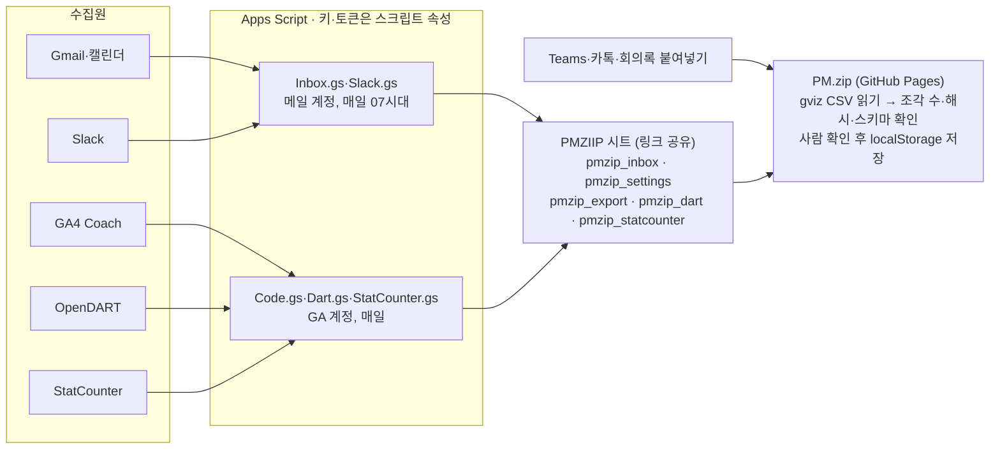

# PM.zip 서비스 IA·기능명세·데이터구조

기준: 2026-11-26 `preview/development` = `main` (PR #44까지). 공유용 편집 문서와 같은 내용이며, 코드가 바뀌면 이 파일을 함께 고친다.

PM.zip은 요구사항 수집부터 과제·성과 확인까지 한 화면에서 다루는 정적 웹앱(GitHub Pages)이다. 실데이터는 Apps Script가 링크 공유 시트에 쓰고, PM.zip이 읽어 각 브라우저에만 저장한다.

## 1. 시스템 구성

- 메일·Slack은 메일 계정으로, GA·공시·점유율은 GA 계정으로 실행되며 같은 시트에 쓴다.
- Teams·카톡은 자동 연결 없이 PM.zip에 직접 붙여넣는다.
- 기록은 브라우저마다 따로이며, 다른 기기에는 시트 연결 정보만 연결 링크로 옮긴다.

## 2. IA (메뉴 구조)

| 메뉴          | 주소                                   | 화면 구성                                                                                                                    |
| ------------- | -------------------------------------- | ---------------------------------------------------------------------------------------------------------------------------- |
| 프로젝트      | `?tab=projects`                        | 월별 프로젝트 개요 · 프로젝트·고객사 추가와 편집 · 보관                                                                      |
| 성과          | `?tab=perf`                            | Galaxy Coach 지표 타일·월별 추이 · 공시 실적 '쉽게 보기' · 국가별 제조사 점유율 표                                           |
| 통합 수집함   | `?tab=inbox`                           | 요구사항 수집(붙여넣기 · 시트 · 파일) → 후보 확인 → 원문 등록 + 과제 초안 · 원문 목록과 상태 · 원문 직접 등록                |
| 개선 과제     | `?tab=work` (측정: `?tab=measurement`) | 과제 목록·필터 · 편집·병합·원문 연결 · 측정 계획(지표 버전, 계획 버전, 월별 전략)                                            |
| 백업·가져오기 | `?tab=data`                            | 시트 연결(Coach GA · 공시 실적 · 국가별 점유율, 열 때마다 자동 동기화) · 기록 백업 · 이전 버전 가져오기 · 다른 기기에서 보기 |

상단의 조회 범위(프로젝트)·조회 월·보관 기록 포함 필터는 프로젝트·수집함·과제에 공통으로 걸리고, 성과 화면에서는 숨긴다.

## 3. 기능명세

모든 지표는 결정적 코드로 계산하고, 결측은 0이 아닌 빈값(N/A)으로 둔다.

| ID      | 기능                          | 화면                               | 입력·출처                                   | 핵심 규칙                                                                                                                        | 상태                                          |
| ------- | ----------------------------- | ---------------------------------- | ------------------------------------------- | -------------------------------------------------------------------------------------------------------------------------------- | --------------------------------------------- |
| F-PRJ   | 고객사·프로젝트 관리          | 프로젝트                           | 직접 입력                                   | 종류 coach·survey·independent, 프로젝트 시간대(IANA), 보관 처리                                                                  | 구현                                          |
| F-SRC   | 원문 등록·상태                | 통합 수집함                        | 직접 입력, 수집                             | 원문은 워크스페이스에 한 번만 보관, 상태 inbox→reviewed→linked→archived, 수정 이력 보존                                          | 구현                                          |
| F-INT   | 요구사항 수집(붙여넣기·Teams) | 통합 수집함 > 요구사항 수집        | 카톡·Teams·회의록 붙여넣기                  | 규칙 `req-rules-2`(오류·변경·결정·요청·질문), Teams 이름·시각 줄 제거, 확인 전 저장 없음, 같은 원문 중복 차단                    | 구현                                          |
| F-INT-S | 시트 수집(Gmail·캘린더·Slack) | 같은 화면, '시트에서 새 메일 확인' | `pmzip_inbox` 탭                            | 자동 알림은 숨김·미선택·후보 없음, 원문 링크 유지, 선택 시 과제 초안 동시 생성                                                   | 구현, 실데이터 확인 (Gmail 189건·Slack 111건) |
| F-WRK   | 개선 과제                     | 개선 과제                          | 직접 입력, 수집 초안                        | 상태 draft→approved→planned→in_progress→released, archived·canceled. 같은 프로젝트 안에서만 병합, 원문 연결                      | 구현                                          |
| F-MSR   | 측정 계획                     | 개선 과제 > 측정                   | 직접 입력, 규칙 제안                        | 지표·계획은 버전(draft→approved), 승인 후 변경은 새 버전, 기준값 미확보는 숫자로 저장 안 함                                      | 구현                                          |
| F-PERF  | 성과                          | 성과                               | GA·공시·점유율 저장분                       | Coach 타일·월별 추이, 공시 '쉽게 보기'(규칙 설명), 국가별 점유율 표                                                              | 구현                                          |
| F-GA    | Galaxy Coach GA 가져오기      | 백업·가져오기                      | `pmzip_export` 탭                           | 정의 `coach-ga4-1.2`와 다르면 거부, REPORT 건수와 유효 점수(1~5) 분리, UU 합산 안 함                                             | 구현, 실데이터 확인                           |
| F-DART  | 공시 실적                     | 백업·가져오기                      | `pmzip_dart` 탭                             | 삼성전자·제일기획·유비온, 분기 누적 → 분기값, 4분기 = 연간 − 3분기 누적                                                          | 구현, 실데이터 확인                           |
| F-SC    | 국가별 제조사 점유율          | 백업·가져오기                      | `pmzip_statcounter` 탭                      | StatCounter 월별, 상위 8개 + 기타, 24개월                                                                                        | 구현, 실데이터 확인                           |
| F-DEV   | 다른 기기에서 보기            | 백업·가져오기                      | 연결 링크(`#connect=`)                      | 시트 연결 정보만 전달, 과제·원문 기록은 옮기지 않음                                                                              | 구현                                          |
| F-BAK   | 백업·가져오기                 | 백업·가져오기                      | JSON 파일                                   | 현재 기록 백업, 이전 프로토타입 JSON 미리보기 후 추가                                                                            | 구현                                          |
| F-AS    | Apps Script 내보내기          | 시트 메뉴 PM.zip, 편집기           | Gmail·캘린더·Slack·GA4·OpenDART·StatCounter | 라벨·채널은 체크로 선택, 결과는 `pmzip_inbox!B1`, 매일 07시대 트리거, Slack 429 대기·재시도, 상한 Gmail 300·캘린더 100·Slack 300 | 구현, 메일 트리거 설치 미확인                 |

## 4. 데이터 구조

### 4.1 브라우저 저장 키 (localStorage)

| 키                                       | 내용                                       | 저장 방식                                         |
| ---------------------------------------- | ------------------------------------------ | ------------------------------------------------- |
| `pmzip:synthetic:v1:{owner}:{workspace}` | 기록 전체(4.2)                             | revision +1 단일 커밋, Web Locks로 동시 저장 차단 |
| `pmzip:coach-ga:v1:…`                    | GA 기간별 집계                             | 추가만(append-only), 같은 파일 중복 거부          |
| `pmzip:coach-ga-source:v1:…`             | 연결한 시트 ID·프로젝트·마지막 동기화 결과 | 덮어쓰기                                          |
| `pmzip:public-fin:v1:…` / `-source`      | 공시 실적 / 연결 정보                      | 추가만 / 덮어쓰기                                 |
| `pmzip:market-share:v1:…` / `-source`    | 국가별 점유율 / 연결 정보                  | 추가만 / 덮어쓰기                                 |

### 4.2 기록 엔티티 (`schemaVersion: 2`, `src/features/records/model.ts`, `src/features/measurement/schema.ts`)

| 엔티티                 | 주요 필드                                                                                                                        | 관계·규칙                                                 |
| ---------------------- | -------------------------------------------------------------------------------------------------------------------------------- | --------------------------------------------------------- |
| workspace              | id, mode(synthetic), name                                                                                                        | clients·projects를 품음                                   |
| client                 | name, description, archivedAt                                                                                                    | workspace 1 : N                                           |
| project                | name, kind(coach·survey·independent), timezone, clientId                                                                         | client 0..1 : N, 월 경계는 프로젝트 시간대                |
| source(원문)           | title, rawText, sourceType(manual·mail·slack·teams·other), reference, collectedAt, requesterRole, sensitivity, status, revisions | 워크스페이스에 1회 보관, 수정 시 revisions에 이전 본 보존 |
| initiative(과제)       | projectId, title, problem, expectedChange, category, priority, status, targetMonth, mergedInto                                   | project N : 1, 병합은 같은 프로젝트·한 단계만             |
| link                   | sourceId, initiativeId                                                                                                           | 원문 N : M 과제, 연결되면 원문 status = linked            |
| metric / metricVersion | projectId, monitoring / version, status(draft·approved), definition                                                              | 승인된 버전은 고치지 않고 새 버전 생성                    |
| plan(측정 계획)        | initiativeId, version, status, supersedesId, hypothesis, baselineDays, observationDays, metrics(역할·목표·기준값·로그 확보), qa  | 과제 1 : N 버전, 기준값 결측은 null                       |
| strategy               | projectId, month, theme, goal, initiativeIds, metricVersionIds                                                                   | 월별 프로젝트 전략                                        |
| audit                  | at, actorId, action, entityId, before, detail                                                                                    | 모든 변경 기록                                            |
| legacy                 | originKey, initiativeId, original                                                                                                | 이전 프로토타입 ID 매핑                                   |

날짜는 UTC로 저장하고 프로젝트 시간대로 표시한다.

### 4.3 공유 시트 탭 (PMZIIP 스프레드시트)

| 탭                                          | 쓰는 쪽                       | 내용                                                                      |
| ------------------------------------------- | ----------------------------- | ------------------------------------------------------------------------- |
| `pmzip_export` / `pmzip_summary`            | Code.gs (GA 계정)             | GA4 Coach 집계 조각 / 사람이 보는 요약                                    |
| `pmzip_dart` / `pmzip_dart_summary`         | Dart.gs                       | 분기별 매출·영업이익·순이익(연결·별도)                                    |
| `pmzip_statcounter` / `_summary` / `_cache` | StatCounter.gs                | 국가×월×제조사 점유율, 이어받기용 캐시                                    |
| `pmzip_inbox`                               | Inbox.gs·Slack.gs (메일 계정) | Gmail·캘린더·Slack 항목, B1 = 마지막 실행 결과                            |
| `pmzip_settings`                            | Menu.gs                       | Gmail 라벨·기간·Slack 채널 입력칸, A열 라벨 체크 목록, E열 채널 체크 목록 |

조각 탭은 A1에 `헤더|v1|조각 수|SHA-256`을 두고, PM.zip은 조각을 이어 붙인 뒤 개수·해시·스키마를 모두 확인해야 저장한다. 토큰·API 키는 Apps Script 스크립트 속성에만 있고 시트에는 쓰지 않는다.

내보내기 형식: `src/lib/connectors/coach-export.ts`, `public-financials.ts`, `market-share.ts`, `inbox-export.ts`(항목 1,000개 이하).

## 5. 미결·다음 작업

- [ ] 메일 자동 수집 트리거를 메일 계정으로 설치(`pmzipInstallInboxTrigger`)
- [ ] GA·공시 수치를 기존 보고서와 대조(미검증)
- [ ] 실기기(모바일 Safari) 화면 검증(자동 테스트는 375·320 폭에서 통과)
- [ ] 자동 알림 필터 적용 후 남는 잘못된 후보를 모아 규칙 보강
- AI 분류는 보류: 회사 명의 Anthropic 조직·결제와 `AGENTS.md`의 승인 범위가 정해지면 'AI 초안'으로 붙인다.
- Supabase(로그인·공유 DB)는 보류: 무료 프로젝트 한도. 그전까지 기록은 브라우저별이다.
- Teams는 자동 연결 없이 붙여넣기로만 수집한다.

관련 문서: [요구사항 수집](REQUIREMENT_INTAKE.md) · [Coach GA 내보내기](COACH_GA_EXPORT.md) · [진행 현황](PROGRESS.md) · [UI 패턴](UI_PATTERNS.md)
